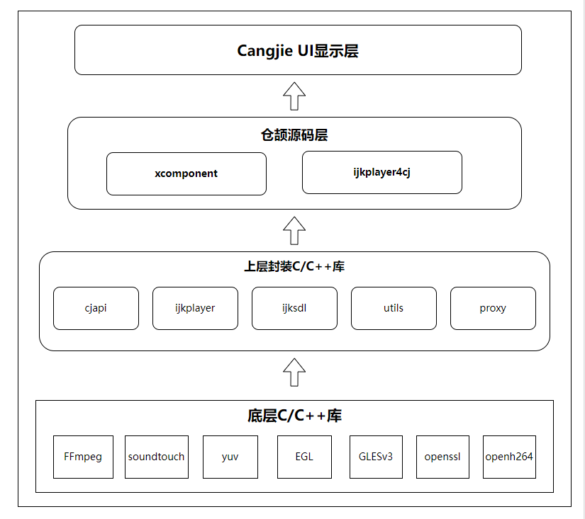

<div align="center">
<h1>ijkplayer-ffi</h1>
</div>

<p align="center">


</p>

## 介绍

ijkplayer-ffi 是仓颉环境下可用的一款基于 FFmpeg 的视频播放器。

### 特性

- 🚀 支持视频播放、暂停、停止、指定到某个点播放、倍数播放、设置音量、设置屏幕常亮、各种视频播放时候的监听

## 软件架构

### 架构图

<p align="center">

</p>

### 源码目录

```shell
|---- ijkplayer-ffi  
|     |---- doc  # API 文档
|     |---- entry  # 示例代码文件夹
|     |---- clibrary # C代码文件夹
|           |---- src  
|                 |---- main 
                        |---- cpp  # CPP模块
                               |----- cjapi     # cangjie 内部业务
                               |----- ijkplayer # ijkplayer内部业务
                               |----- ijksdl    # ijkplayer内部业务
                               |----- napi      # 封装NAPI接口
                               |----- proxy     # 代理提供给NAPI调用处理ijkplayer内部业务
                               |----- third_party #三方库依赖 
                               |----- utils     #工具
|     |---- ijkplayer  # library库文件夹
|           |---- src  
|                 |---- main  
|                       |----- cangjie       #仓颉模块
|                              |----- src    
|                                      |----- ijk_media_player #仓颉代码
|                                      |----- cjapi_ffi #互操作方法声明
|                                      |----- ijkplayer_cj #互操作方法
|                                      |----- xcomponent_interop #xcomponent组件
|     |---- README.MD  # 安装使用方法     
```

### 接口说明

主要类和函数接口说明详见 [API](./doc/feature_api.md)

## 使用说明

### 编译构建

用devecostudio打开项目,然后点击run按钮直接运行app即可自动编译成功

### 把ijkplayer作为三方库引入
```cj
用户如何在自己项目里引入ijk，具体步骤如下：
1. 在自己项目的根目录下,建一个thirdparty目录,然后通过git命令,把自己需要的ijk分支拉下来,比如
   git clone -b 分支名  https://gitcode.com/Cangjie-TPC/ijkplayer-ffi.git
2. 把 thirdparty文件下的ijk项目用deveco编译通过，方法如上面的编译构建
3. 在自己项目的根目录的build-profile.json5文件里的modules节点下添加
   {
   "name":"ijkplayer",
   "srcPath": "./thirdparty/ijkplayer-ffi/ijkplayer"
   },
   {
   "name":"clibrary",
   "srcPath": "./thirdparty/ijkplayer-ffi/clibrary"
   }
   把ijkplayer库的两个依赖变为modeule依赖形式.然后同步项目
4. 在自己项目的enrty里的oh-package.json5里的dependencies里加上 "ijkplayer": "file:../thirdparty/ijkplayer-ffi/ijkplayer",然后同步项目
   "dependencies": {
     "ijkplayer": "file:../thirdparty/ijkplayer-ffi/ijkplayer",
     "libark_interop_loader.so": "file:./src/main/cangjie/loader"
   }
   项目即依赖成功
   另外注意该项目需要网络权限
```

### 功能示例

在UI中配置XComponent控件

```cj
    XComponent("xcomponentId", "surface", "ijkplayer_napi").onLoad {
        => initDelayPlay()
    }.width(100.percent).height(300)
    .id("xcomponentId")

```
播放

```cj
//设置XComponent回调的context
        //单例
        let mIjkMediaPlayer: IjkMediaPlayer = IjkMediaPlayer.getInstance()
        //多实例
        //let mIjkMediaPlayer: IjkMediaPlayer = IjkMediaPlayer("xcomponentId")
        this.mIjkMediaPlayer.setContext("xcomponentId")
        if (this.playStatus == PlayStatus.INIT) {
            this.mIjkMediaPlayer.reset()
        }
        this.playStatus = PlayStatus.PLAY
        //设置debug模式
        this.mIjkMediaPlayer.setDebug(true)
        //初始化配置
        this.mIjkMediaPlayer.native_setup();
        // 初始化配置后需要重新设置音频流音量，否则音量为默认值1.0
        this.mIjkMediaPlayer.setVolume(this.volume.toString(), this.volume.toString());
        //设置视频源
        this.mIjkMediaPlayer.setDataSource(url);
        //设置视频源http请求头
        let headers = HashMap<String, String>()
        headers.put("user_agent", "Mozilla/5.0 BiliDroid/7.30.0 (bbcallen@gmail.com)")
        headers.put("referer", "https://www.bilibili.com")
        this.mIjkMediaPlayer.setDataSourceHeader(headers);
        //使用精确寻帧 例如，拖动播放后，会寻找最近的关键帧进行播放，很有可能关键帧的位置不是拖动后的位置，而是较前的位置.可以设置这个参数来解决问题
        this.mIjkMediaPlayer.setOption(IjkMediaPlayer.OPT_CATEGORY_PLAYER, "enable-accurate-seek", "1");
        //预读数据的缓冲区大小
        this.mIjkMediaPlayer.setOption(IjkMediaPlayer.OPT_CATEGORY_PLAYER, "max-buffer-size", "102400");
        //停止预读的最小帧数
        this.mIjkMediaPlayer.setOption(IjkMediaPlayer.OPT_CATEGORY_PLAYER, "min-frames", "100");
        //启动预加载
        this.mIjkMediaPlayer.setOption(IjkMediaPlayer.OPT_CATEGORY_PLAYER, "start-on-prepared", "1");
        // 设置无缓冲，这是播放器的缓冲区，有数据就播放
        this.mIjkMediaPlayer.setOption(IjkMediaPlayer.OPT_CATEGORY_PLAYER, "packet-buffering", "0");
        //跳帧处理,放CPU处理较慢时，进行跳帧处理，保证播放流程，画面和声音同步
        this.mIjkMediaPlayer.setOption(IjkMediaPlayer.OPT_CATEGORY_PLAYER, "framedrop", "5");
        // 最大缓冲cache是3s， 有时候网络波动，会突然在短时间内收到好几秒的数据
        // 因此需要播放器丢包，才不会累积延时
        // 这个和第三个参数packet-buffering无关。
        this.mIjkMediaPlayer.setOption(IjkMediaPlayer.OPT_CATEGORY_PLAYER, "max_cached_duration", "3000");
        // 无限制收流
        // this.mIjkMediaPlayer.setOption(IjkMediaPlayer.OPT_CATEGORY_PLAYER, "infbuf", "1");
        // this.mIjkMediaPlayer.setOptionLong(IjkMediaPlayer.OPT_CATEGORY_PLAYER, "infbuf", "1")
        // 屏幕常亮
        this.mIjkMediaPlayer.setScreenOnWhilePlaying(true,GlobalContext.getContext().getOrThrow());
        // 设置超时
        this.mIjkMediaPlayer.setOption(IjkMediaPlayer.OPT_CATEGORY_FORMAT, "timeout", "10000000");
        this.mIjkMediaPlayer.setOption(IjkMediaPlayer.OPT_CATEGORY_FORMAT, "connect_timeout", "10000000");
        this.mIjkMediaPlayer.setOption(IjkMediaPlayer.OPT_CATEGORY_FORMAT, "addrinfo_timeout", "10000000");
        this.mIjkMediaPlayer.setOption(IjkMediaPlayer.OPT_CATEGORY_FORMAT, "dns_cache_timeout", "10000000");
        // 变速播放
        this.mIjkMediaPlayer.setOption(IjkMediaPlayer.OPT_CATEGORY_PLAYER, "soundtouch", "1");
        this.mIjkMediaPlayer.setSpeed(this.playSpeed);
        let Speed = this.mIjkMediaPlayer.getSpeed()
        AppLog.info("getSpeed--" + Speed.toString())
        //是否开启循环播放
        this.mIjkMediaPlayer.setLoopCount(true)
        this.mIjkMediaPlayer.setOnVideoSizeChangedListener({width: Int32, height: Int32, sar_num: Int32, sar_den: Int32 =>
            if (height == 0) {
                return
            }
            let va = Float64(width) / Float64(height)
            let vpa = Float64(this.videoParentAspectRatio)
            if (vpa > va) {
                this.videoWidth = Length((Float64(width) / (Float64(height) * vpa)) * 100.0, unitType: percent)
            } else {
                this.videoWidth = Length(100, unitType:  percent)
            }
            if (width > 0 && height > 0) {
                this.videoAspectRatio = Float64(width) / Float64(height)
            }
            LogUtils.getInstance().LOGI("setOnVideoSizeChangedListener-->go:" + width.toString() + "," + height.toString() + "," + sar_num.toString() + "," + sar_den.toString())
            this.getVideoSize()
            //that.hideLoadIng()
        })
        this.mIjkMediaPlayer.setOnPreparedListener({=>
            AppLog.error("进来了setOnPreparedListener")
        })
        this.mIjkMediaPlayer.setOnTimedTextListener({ str=>
            AppLog.error("进来了setOnTimedTextListener"+ str)
        })
        this.mIjkMediaPlayer.setOnCompletionListener({=>
            AppLog.error("进来了 结束")
        })
        this.mIjkMediaPlayer.setOnSeekCompleteListener({=>
            AppLog.error("进来了 seek")
        })
        this.mIjkMediaPlayer.setOnErrorListener({ what, extra =>
            AppLog.error("进来了 error ${what} ${extra}")
        })
        this.mIjkMediaPlayer.setOnInfoListener({what, extra=>
            AppLog.error("进来了 info ${what} ${extra}")
        })
        this.mIjkMediaPlayer.setOnBufferingUpdateListener({percent =>
            AppLog.error("进来了 BufferingUpdate ${percent}")
        })
        this.mIjkMediaPlayer.setMessageListener()
        this.mIjkMediaPlayer.prepareAsync()
        this.mIjkMediaPlayer.start()
```

暂停

```cj
mIjkMediaPlayer.pause();
```

停止

```cj
mIjkMediaPlayer.stop();
```

重置

```cj
mIjkMediaPlayer.reset();
```

释放

```cj
mIjkMediaPlayer.release();
```
跳到指定时间节点的视频处

```cj
mIjkMediaPlayer.seekTo(10);
```
倍数播放

```cj
mIjkMediaPlayer.setOption(IjkMediaPlayer.OPT_CATEGORY_PLAYER, "soundtouch", "1");
mIjkMediaPlayer.setSpeed("2");
```

循环播放

```cj
mIjkMediaPlayer.setLoopCount(true);
```

设置音量

```cj
mIjkMediaPlayer.setVolume(0, 1);
```


## 约束与限制

支持视频格式:
- .mp4 .m3u8 .mov

在下述版本验证通过：

- DevEco Studio: DevEco Studio 5.0.0 Release Build Version 5.0.3.910
                 DevEco Studio 5.0.0 Release Build Version 5.0.3.906
- Cangjie support Plugin: DevEco Studio-Cangjie Plugin Beta2(5.0.3.906)


## 开源协议 License

本项目基于 [LGPLv2.1 or later](LICENSE)，请自由地享受和参与开源。

## 参与贡献

欢迎给我们提交PR，欢迎给我们提交Issue，欢迎参与任何形式的贡献。